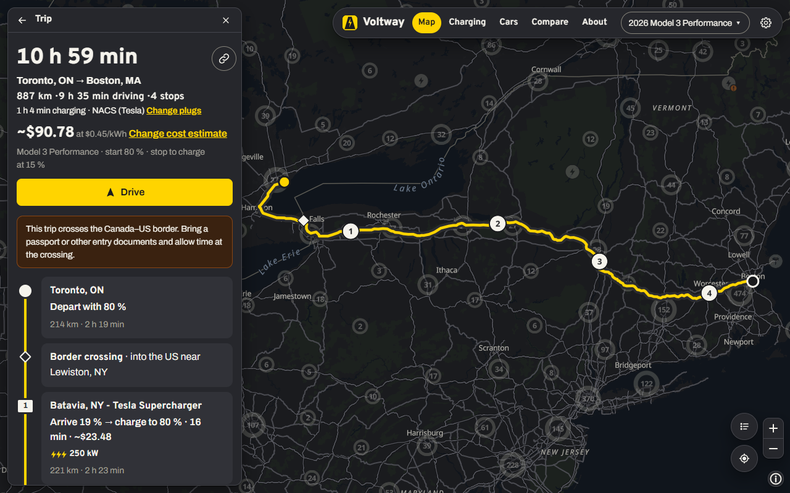
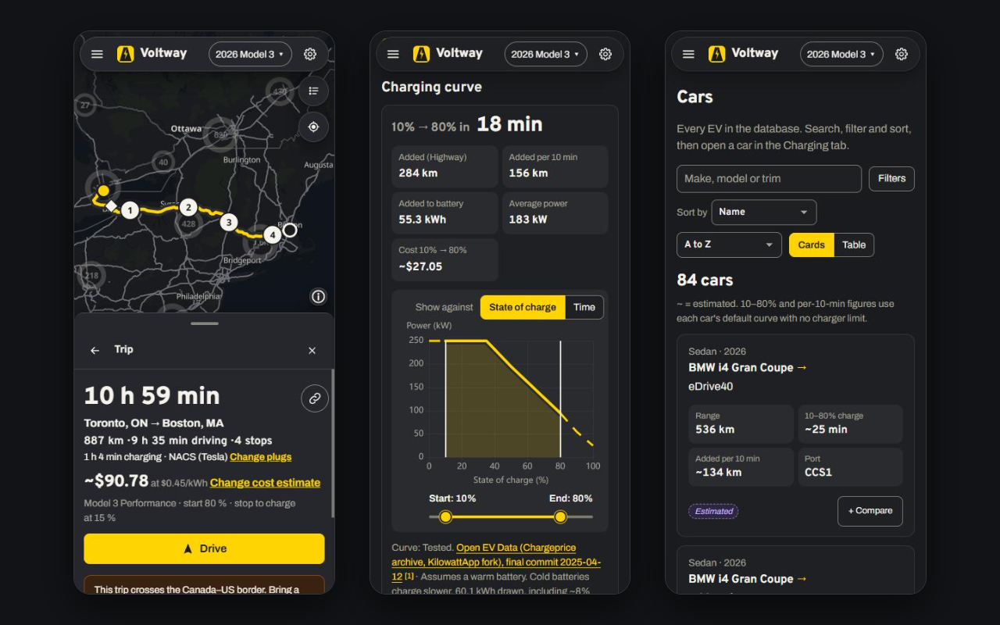

# Voltway

Voltway is a free, no-login website for EV drivers and shoppers. It shows EV specs and charging curves where **every figure shows its source**, a map of public chargers across Canada and the US, and a trip planner that picks charging stops for your car.

**Live site:** https://voltway-routing.vercel.app/





## What it does

- **Charger map.** Public Level 2 and Level 3 stations in Canada and the US, grouped into rings that show the mix of fast and slow chargers. Filter by level, power and plug, or turn on *My car* to see only the plugs your car can use. Each pin shows its speed (one to three bolts: under 150 kW, 150 to 250 kW, 250 kW and up) and opens a panel with the station's details and where the data came from.
- **Trip planner.** Pick a start, a destination and your car, and Voltway picks charging stops from the car's charging curve and plugs, with the charge time, the arrival and departure charge, and a cost estimate for each stop. Trips can cross the Canada–US border (or stay on one side of it), avoid tolls or highways, and hand off to Google Maps or Apple Maps to drive.
- **Charging curves.** For each car: the curve against state of charge or time, the 10–80 % time, the distance added per 10 minutes, and the cost of a charge. Every figure is labelled *Official*, *Tested*, *Estimated* or *Unknown*, and links to its source.
- **Cars and Compare.** Search, filter and sort the 84 variants sold in Canada, then compare up to four side by side, including a "charge race" of their curves.

Car data covers EVs sold in Canada today. The data model and the interface are built so more markets can be added.

## How it's built

- **[Astro](https://astro.build)** static site in TypeScript, with interactive parts as **React** islands.
- **[MapLibre GL JS](https://maplibre.org/)** for the map, on [OpenFreeMap](https://openfreemap.org/) tiles with Voltway's own dark and light styles.
- **[ECharts](https://echarts.apache.org/)** for the charging curves and **MiniSearch** for in-browser search.
- **Data as JSON files** in this repo (`data/`), validated against the JSON Schemas in `schema/` at build time. The build fails on any figure that has no source.
- **Routing** through [openrouteservice](https://openrouteservice.org/), called from two Vercel Functions (`src/pages/api/route.ts` and `geocode.ts`) so the key stays on the server. Everything else is static.
- Hosted on **Vercel**. GitHub Actions run CI on every pull request, a monthly charger-map refresh that merges itself once its sanity checks pass, and a monthly check of the car datasets that opens a pull request for a person to review.
- Tests with **Vitest**.

## Running it locally

```bash
npm install
npm run dev        # builds the data, then starts the dev server on http://localhost:4321
npm test           # unit tests
npm run check      # astro check (types)
npm run build      # validate the data, build it, then build the site
```

The trip planner needs an openrouteservice key: copy `.env.example` to `.env` and set `ORS_API_KEY`. The rest of the site works without one.

Data scripts (`npm run fetch:*`, `import:*`, `gaps`, `calibrate`) download and import the source datasets; see `package.json` and `scripts/`.

## Docs

- Design (the source of truth): [`docs/design/`](docs/design/), starting with `overview.md`.
- Build plan and QA: [`docs/plan/`](docs/plan/).
- Known shortcuts and follow-ups: [`docs/tech-debt/`](docs/tech-debt/).

## Data sources and credits

Full credits, with each licence, are on the site's [About & sources](https://voltway-routing.vercel.app/about) page.

**Cars**
- **NRCan Fuel Consumption Ratings (battery-electric vehicles)**, Natural Resources Canada: which cars are sold in Canada, with official range and energy use. Open Government Licence – Canada.
- **[OpenEV Data](https://github.com/open-ev-data/open-ev-data-dataset)**: battery size, charging power, ports and other specifications. CDLA-Permissive-2.0.
- **[Open EV Data](https://github.com/KilowattApp/open-ev-data)** (Chargeprice archive): charging curves for older models, simplified from Fastned's published charts. MIT License with Attribution Requirement, Copyright (c) 2024 Tijs Teulings; full notice in `src/licenses/open-ev-data-mit.txt`.

**Chargers**
- **[Alternative Fuel Stations (AFDC)](https://developer.nlr.gov/docs/transportation/alt-fuel-stations-v1/all/)**, U.S. DOE / NLR (Canadian records from Natural Resources Canada): public Level 2 and Level 3 stations in Canada and the US, refreshed monthly. Used under the [NLR data terms](https://www.nlr.gov/disclaimer).
- **[Open Charge Map](https://openchargemap.org/)**: public stations the AFDC data is missing, from open-licensed records only (CC BY 4.0 for Open Charge Map contributors' data). Each station names its provider and licence.

**Trip planner**
- **[GeoNames](https://www.geonames.org/)**: place names for the From and To suggestions. CC BY 4.0.
- **[Natural Earth](https://www.naturalearthdata.com/)**: Canada and US outlines, used to keep a trip on one side of the border when asked. Public domain.
- **[openrouteservice](https://openrouteservice.org/)**: driving routes and address search.

**Base map**
- © [OpenStreetMap](https://www.openstreetmap.org/copyright) contributors.
- Map tiles by [OpenFreeMap](https://openfreemap.org/), built on the OpenMapTiles schema (© OpenMapTiles). The map styles are based on Positron, from CARTO basemaps designed by Stamen and Paul Norman.

## Feedback

Spotted a wrong or missing figure? [Open an issue](https://github.com/MahAbdulKhaliq/voltway/issues) with the car and, if you can, a source.

Built by [Mahmood Abdul-Khaliq](https://mahabdulkhaliq.github.io/).
